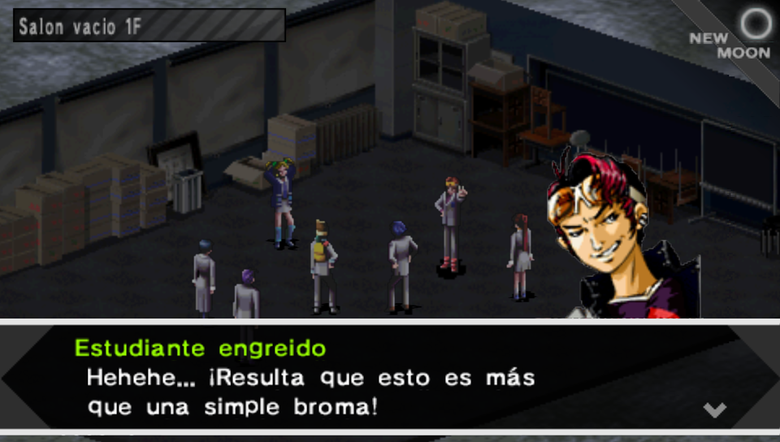
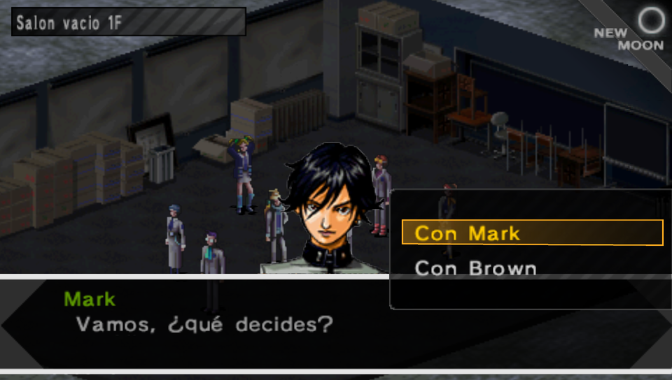

# Persona (PSP) en español latino

Parche de traducción al español latino de **Shin Megami Tensei: Persona** para PSP, el remake del primer Persona. Es para la versión **Europa de PSN** (`NPEH-00069`).

Este proyecto continúa la [traducción de Jose-Chavez96](https://github.com/Jose-Chavez96/Traduccion_persona_es), que dejó el diálogo de la historia traducido y las herramientas para reinsertarlo. Sobre esa base se retradujo todo el texto y se terminó lo que faltaba.

> **Estado:** en pruebas. El parche ya tiene todo traducido, pero todavía no se ha jugado completo de principio a fin. Si encuentras algo raro, abre un issue con una captura.

<p>
  
  
</p>

## Qué cambió respecto al parche original

- **Retraducción completa** de la historia (`e0` a `e4`) y de las 28 negociaciones con demonios, escena por escena, buscando fidelidad al inglés y un español latino neutro.
- **Acentos, ñ, ¿ y ¡.** La fuente del juego no los traía. Se dibujaron las letras nuevas y se agregaron al EBOOT.
- **Interfaz:** menús, nombres de objetos, equipo y habilidades, descripciones y mensajes de sistema.
- **Texto dibujado en imágenes**, como las etiquetas de los menús, la tienda y los resultados de batalla.
- **Bugs del parche original arreglados:** pedazos de diálogo en inglés entre frases, punteros de diálogo descuadrados, frases cortadas en las negociaciones, entre otros.

Algunos nombres van abreviados ("Inc. Fue.") o se quedan en inglés (la serie Jagd, Sturm y Spiegel), porque el juego solo deja escribir cada nombre en el espacio que ocupaba el inglés.

## Cómo aplicar el parche

1. Consigue tu propia copia del juego. Tiene que ser la versión Europa de PSN, con este MD5:

   | ISO | MD5 |
   |---|---|
   | Original (`NPEH-00069`) | `03ee31f32bcd3bb697de347fba4493d9` |

   Si el MD5 no coincide, el parche no aplica. La versión USA (`ULUS-10432`) todavía no está soportada.

2. Descarga `patches/persona_es_full.xdelta`.

3. Aplícalo con xdelta:
   - **Windows:** [Delta Patcher](https://github.com/marco-calautti/DeltaPatcher) o xdelta UI. Eliges la ISO original, el parche y dónde guardar la nueva.
   - **Linux o macOS:**
     ```
     xdelta3 -d -s "Persona.iso" persona_es_full.xdelta "Persona_ES.iso"
     ```

4. Juega la ISO nueva en PPSSPP o en una PSP.

## Compilar el parche desde el código

Solo hace falta si quieres modificar la traducción. El repo no trae ningún archivo ni texto del juego, así que primero se sacan de tu ISO.

Necesitas Python 3, `xdelta3`, [pspdecrypt](https://github.com/John-K/pspdecrypt) compilado en `../externos/pspdecrypt/` y la fuente [Noto Sans variable](https://github.com/google/fonts/raw/main/ofl/notosans/NotoSans%5Bwdth,wght%5D.ttf) en `../externos/fuentes/`. Las dos carpetas van junto al repo, no dentro.

```
export PERSONA_ISO_EU=~/ruta/a/Persona.iso
python3 tools/original.py restaurar "$PERSONA_ISO_EU"
bash tools/compilar_todo.sh
```

`restaurar` lee de tu ISO el texto original de cada registro, los archivos de menú y fuente, el EBOOT y el inglés de las tablas de la interfaz y de los calabozos. `compilar_todo.sh` arma `rebuilt/persona_es_full.iso` y `patches/persona_es_full.xdelta`.

### Dónde está cada cosa

| Carpeta | Qué tiene |
|---|---|
| `translated_text/` | La traducción de la historia y las negociaciones, registro por registro |
| `huecos.json` | Pedazos de diálogo que quedan entre registros |
| `_eboot/` | Traducción de la interfaz: menús, objetos, habilidades y mensajes |
| `_dng/tabla.tsv` | Mensajes de los calabozos y mapas, como puertas cerradas |
| `_tex/imagenes_es.json` | Etiquetas de las imágenes de los menús |
| `scripts/`, `tools/` | Herramientas para extraer, reinsertar, verificar y compilar |
| `glossary.json`, `glosario_hablantes.json` | Nombres y términos fijos |

## Hecho con ayuda de IA

La retraducción, las herramientas nuevas y los arreglos se hicieron con ayuda de **Claude** (Anthropic), usando Claude Code, con revisión y decisiones de una persona. El parche original de Jose-Chavez96 también se hizo con Claude.

## Legal

- Es una traducción hecha por fans, sin fines de lucro.
- **No se distribuye el juego ni archivos suyos.** El `.xdelta` solo tiene las diferencias y no sirve sin tu propia copia.
- Persona y Shin Megami Tensei son propiedad de Atlus y SEGA. Este proyecto no está afiliado a ellos ni lo respaldan.
- Si Atlus o SEGA piden quitar algo, se quita.

## Créditos

- **Traducción original y herramientas base:** [Jose-Chavez96](https://github.com/Jose-Chavez96) (`Quete_importa`).
- **Retraducción, interfaz y arreglos:** [jayss1e](https://github.com/jayss1e), con Claude.
- **Herramientas de terceros:** [xdelta3](https://github.com/jmacd/xdelta), [pspdecrypt](https://github.com/John-K/pspdecrypt), [PPSSPP](https://www.ppsspp.org/) y [Noto Sans](https://fonts.google.com/noto) (licencia OFL).
